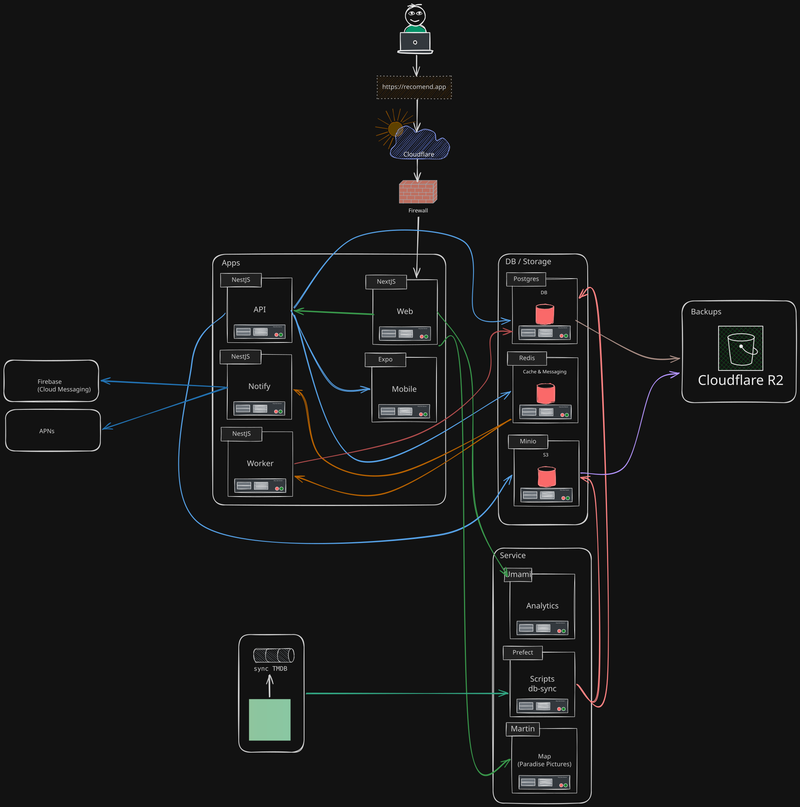
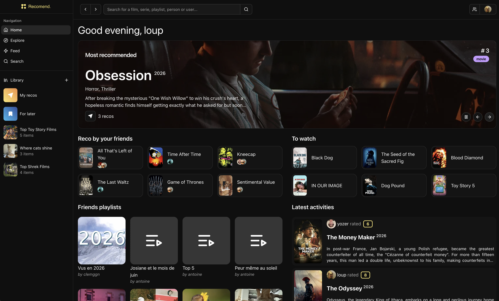

# 🎬 Recomend

<p align="center">
  
</p>

Monorepo of the **Recomend** app, dev by [@lxup](https://github.com/lxup).

[](./LICENSE)

## ✅ TODO

- [ ] Update english translations

## 🚀 Tech Stack

- ⚡️ [Next.js](https://nextjs.org/) – React Framework
- 💳 [RevenueCat](https://www.revenuecat.com/) – Subscriptions
- 📲 [Firebase Cloud Messaging](https://firebase.google.com/docs/cloud-messaging) – Push Notifications
- ☁️ [Cloudflare R2](https://www.cloudflare.com/products/r2/) – Backups
- ⚙️ [Prefect](https://www.prefect.io/) – DB Sync Scripts (with TMDB)
- 🎞️ [TMDB](https://www.themoviedb.org/) – Movie & TV Metadata Provider

<p align="left">
  
</p>

## 📸 Preview



## 📦 Installation

```bash
bun install
cp .env.template .env.local
# Add your environment variables to .env.local
bun run start
```

### Local ports

Everything in development lives in **19000-19019**, so the repo can run alongside other
projects without colliding on 3000, 6379 or 8108. The host ports come from `.env`; the
container ports behind them are untouched, as are the defaults the deployed images use.

| Port  | Service        | Set in                                  |
| ----- | -------------- | --------------------------------------- |
| 19000 | web            | `apps/web/project.json` (`next dev -p`) |
| 19001 | api            | `apps/api/.env`                         |
| 19002 | notify         | `apps/notify/.env`                      |
| 19003 | worker         | `apps/worker/.env`                      |
| 19004 | mobile (Metro) | `apps/mobile/project.json`              |
| 19010 | postgres       | `.env` (`DB_PORT`)                      |
| 19011 | redis          | `.env` (`REDIS_PORT`)                   |
| 19012 | typesense      | `.env` (`TYPESENSE_PORT`)               |
| 19013 | s3 (rustfs)    | `.env` (`S3_PORT`)                      |
| 19014 | s3 console     | `.env` (`S3_CONSOLE_PORT`)              |

Mobile needs its port pinned explicitly: `@nx/expo:start` defaults Metro to 19000, which
is the web app's port here, while `expo run:ios` and `expo run:android` default to 8081.

## 🤝 Contributing

Contributions are welcome! See [CONTRIBUTING.md](./CONTRIBUTING.md) for how to submit issues and pull requests.

## 📄 License

This project is licensed under the [GNU Affero General Public License v3.0](./LICENSE) (AGPL-3.0-or-later).

This means you are free to use, study, modify and share this code, including running a modified version as a network service — but any modified version you distribute or run as a service must also be made available under the same license, with its source code accessible to its users.
